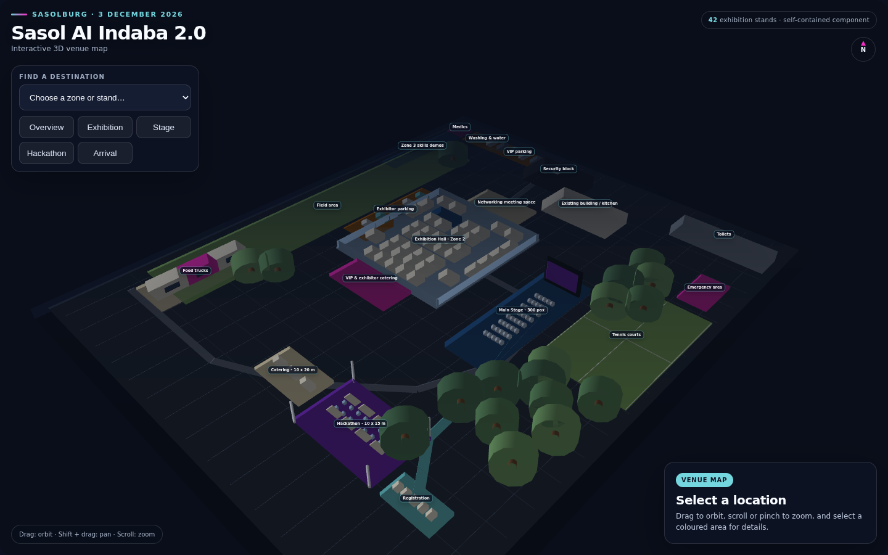

# Sasol AI Indaba 2.0 - Sasolburg 3D venue map

A responsive, framework-neutral Web Component built from the supplied event-planning PDF for **3 December 2026**. It combines the overall venue plan, the detailed 42-stand exhibition layout, and the hackathon/catering/registration detail into one navigable 3D scene.



## Included

- Interactive WebGL 2 venue model with orbit, pan, zoom, pointer and touch controls
- 42 individually selectable exhibition stands
- Searchable destination list and camera presets
- Selectable program, food, arrival, parking, facility and safety zones
- `locationselect` custom event for app integration
- Shadow DOM styling and a responsive mobile layout
- Source, two self-contained browser bundles, demo and preview images
- **No runtime libraries, CDN calls or external image assets**

## Quick start - no framework

Host the package from a web server, then load the prebuilt classic bundle:

```html
<script src="./dist/ai-indaba-map.iife.js"></script>
<ai-indaba-map style="display:block;width:100%;height:720px"></ai-indaba-map>
```

Do not open the demo directly with `file://`; browsers require a local HTTP server for module imports.

## ESM / bundler integration

```js
import './dist/ai-indaba-map.js';

const map = document.querySelector('ai-indaba-map');
map.addEventListener('locationselect', (event) => {
  console.log(event.detail.id, event.detail.name);
});

map.focusLocation('registration');
// Other examples: exhibition, main-stage, hackathon, booth-1 ... booth-42
```

```html
<ai-indaba-map id="venue-map" style="display:block;height:720px"></ai-indaba-map>
```

The custom element works in vanilla JavaScript and in React, Angular, Vue, Blazor or other frameworks that can host a standard browser custom element.

## Run the included demo

```bash
npm run build
npm run serve
```

Then open `http://localhost:4173/demo/`.

The build script uses only Node.js. It combines the editable data and component source into `dist/ai-indaba-map.js` and `dist/ai-indaba-map.iife.js`; no package installation is required.

## Public API

### Methods

- `focusLocation(id)` - select and fly to a location or numbered stand
- `resetView()` - restore the full-site camera
- `getLocations()` - return serializable destination metadata

### Selection event

```js
map.addEventListener('locationselect', ({ detail }) => {
  // detail: { id, name, category, description }
});
```

## Customising locations

Edit `src/map-data.js`, then run `npm run build`. The venue objects are data-driven. Exhibition assignments can be added to the 42 stand records when those names become available.

## Source interpretation and accuracy

The geometry is an app-ready **visual interpretation**, not a survey, CAD drawing, emergency plan or construction model. Relative placement follows the supplied PDF. Labels and explicitly stated capacities/dimensions are preserved, while unlabelled distances, elevations, object heights and landscaping are approximate. Validate final routing, accessibility, emergency and operational information with the event and site teams before attendee-facing deployment.

## Browser support

A current WebGL 2-capable version of Chrome, Edge, Firefox or Safari is required. The component displays a clear compatibility message if WebGL 2 is unavailable.
